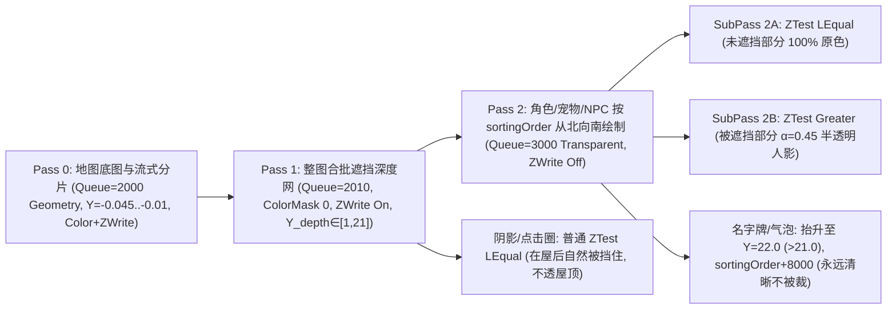

# 地图区域与遮挡人物半透明化技术设计方案

> 关联背景：2026-11-16 历史讨论复核与落盘（基于 2026-11-27 当前 `mmorpg-client` `main` 分支实测代码）  
> 目标形态：同时满足「微信/抖音小游戏（WebGL2 / OpenGL ES 3.0 单线程）」与「iOS/Android 原生 App（IL2CPP / AOT）」双形态约束  
> 当前状态：**代码、着色器、编辑器与 EditMode 单测已全部落地并通过 Unity 6000.6.0f1 验证（85/85 绿灯）**；待接入具体新地图后，即可直接在 `MMORPG → Maps → NavMesh 导航编辑器` 的「视觉遮挡层」勾画遮挡轮廓并导出 `occlusion.json` 生效。

---

## 0. 对 2026-11-16 历史讨论的逐项核对结论

历史讨论中的**大方向完全正确**，但在结合当前客户端实际代码（2026-11-27 现状）后，有 **3 处关键事实需要修正与升级**，避免直接照搬旧方案踩坑：

| 历史讨论结论 | 复核判定 | 结合本仓现状的实测依据与修正 |
| --- | --- | --- |
| 区分「① 进区域整人半透明」与「② 树/房后遮挡透视半透明」，走到房屋后面要看见人影必须用② | **✅ 正确** | 单纯降低人物 `SpriteRenderer.color.a` 仍会被前景完全盖住；只有把「正常前后遮挡」与「被遮区域半透明显示」结合，才能实现露在屋外的身体清晰、屋后部分半透明的效果。 |
| 不用 NavMesh，遮挡数据与 NavMesh 严格分离 | **✅ 正确** | 屋檐下、树冠下、牌坊下可通行但会遮挡角色。NavMesh（`NavMeshAuthoringDraft` / 服务端 Detour MSET）只管“能不能走”和服务端移动校验；遮挡轮廓纯客户端视觉，只管“怎么看”，绝不耦合、不重烘 MSET、不改协议。 |
| “当前客户端人物已用 `SpriteRenderer` 绘制” | **✅ 正确（附隐患）** | 玩家（`QdaoBoySpriteAnimator`）、宠物（`QdaoPetSpriteAnimator`）、NPC（`TianyongCityNpcs`、`GuiyuanCityNpcActor`）均为 `SpriteRenderer`，按 `WorldSortingOrder`（`round(-depth * 10)`）排序。**实测发现一处现存隐患**：`GuiyuanCityNpcActor.AttachDedicatedSprite` 把 `WorldLabelBillboard` 挂到了 NPC 立绘本体上（附加了 `+8000` 名字牌层级偏移），接入遮挡前需修正，否则专属 NPC 立绘会永远压在前景与玩家头上。 |
| “地图前景已有按脚底位置判断前后遮挡的处理” | **⚠️ 仅旧原型成立，新图尚未建设** | 旧天墉城 `TianyongPaintedForeground.cs` 只有 2 盏灯柱的硬编码扫描线梯形原型；**当前正式地图（`CurrentMapBuilder` + `CurrentMapTileStreaming`）与 36 张端游/道家 Q 版新图（`PcOriginalMapPreviewViewer`）全部是单层平铺静态底图，没有任何前景遮挡物**（`CurrentMapTests.cs` 甚至显式断言无 `TianyongPaintedForeground`）。 |
| 沿用旧前景抠图（从底图瓦片重新采样画一遍房子）+ 半透明补绘 | **🔄 建议升级为更优方案** | 旧 `TianyongPaintedForeground` 直接持有常驻瓦片 `Texture2D`，而新图采用**流式分片加载与淘汰**（`CurrentMapTileStreaming` 共享 6 片显存预算、`PcOriginalMapPreviewViewer` 24 片预算）。若前景私自引用分片纹理，卸载后会变白或击穿小游戏内存预算。**本仓 Built-in RP + 正交俯视相机下，推荐采用「无贴图深度遮罩 + 角色双 Pass 深度测试着色器」**（下文 §2.2），零重复贴图显存、自动兼容流式分片与双节皮肤、整图遮挡仅 1 个 DrawCall，并原生支持斜向建筑接地线。 |

---

## 1. 需求分析

### 1.1 两类视觉需求及优先级

1. **核心需求（场景②：建筑/树木/柱子后的遮挡透视半透明，主力落地）**
   - 角色、宠物（及按需配置的 NPC）走到房屋屋檐、树木树冠、石柱、牌坊等前景物件**北侧（后方）**时：
     - **未被遮挡的身体部分**保持 100% 不透明清晰显示；
     - **被遮挡的身体部分**在前景之上以半透明人影（如 `alpha = 0.45`，可配微调色）透出，玩家始终能定位角色位置与动作；
     - **脚底阴影（`shadow`）**在建筑后方时正常被建筑盖住，不穿透屋顶；
     - **头顶/脚下名字牌（`WorldLabelBillboard`）与聊天气泡**始终清晰可读，不被建筑遮挡变暗。
   - 角色走到同一建筑**南侧（前方）**时，人物 100% 不透明立于建筑之前，不触发任何半透明。
2. **可选扩展（场景①：特殊区域整人半透明，如草丛、薄雾、潜行区，按需启用）**
   - 进入配置的区域多边形后，根据角色脚底 `(x, z)` 判定，整体不透明度在约 `0.2s` 内平滑从 `1.0` 过渡到目标值（如 `0.5`），离开后平滑恢复。
   - 多个区域重叠时统一取最小目标透明度，避免离开其中一个区域时误恢复为 `1.0`。

### 1.2 边界与硬约束

- **纯客户端视觉**：不修改任何网络协议、不向服务端上报遮挡状态、不影响寻路/碰撞/战斗权威判定。
- **不污染 NavMesh**：不写入 `NavMeshAuthoringDraft.bakedData` 或服务端 `world-y-up.obj` / MSET，不因编辑遮挡触发服务端重烘。
- **双形态兼容（小游戏 WebGL2 + iOS/Android App IL2CPP）**：
  - 仅使用 OpenGL ES 3.0 / WebGL2 基础深度测试（无 Compute Shader、无 Geometry/Tessellation Shader、无 GrabPass、无额外 RenderTexture 拷贝）；
  - 严格控制 Shader 变体数（每个 Shader 仅 1 个变体），不塞入 `Always Included Shaders`，通过 `Resources` 材质显式引用防构建裁剪；
  - 零托管多线程、零异步文件 IO、每帧热路径零 GC 分配；
  - 绝不突破 `CurrentMapTileStreaming`（6 片）与小游戏 WebAssembly 内存预算。

---

## 2. 设计分析

### 2.1 当前客户端渲染基线（实测代码现状）

- **渲染管线**：Built-in Render Pipeline（`ProjectSettings/GraphicsSettings.asset` 中 `m_CustomRenderPipeline: {fileID: 0}`）；SortingLayer 当前仅有 `Default`。
- **相机模型**：2.5D 贴图地图均由 `TianyongCameraController` 驱动为**正交直俯视相机**（`orthographic = true`，`rotation = Euler(90, 0, 0)`，`CameraDistance = 110`，`nearClipPlane = 0.3`，`farClipPlane = 500`，`transparencySortMode = CustomAxis(0,0,1)`）。
  - 关键几何特性：正交直俯视下，改变视觉子物体的世界 `Y` 坐标（沿视线方向）**产生零像素偏移、零缩放、零视差**。
- **现有层级分布**：
  - 地图底图 / 流式高清分片：`Y = -0.045` / `-0.04` / `-0.01`，`RenderQueue.Geometry (2000)`，`Unlit/Texture`（写深度）。
  - 点击圈 `TianyongClickMarker`：`Y = GroundLift`，`Sprites/Default`（`ZTest LEqual`、`ZWrite Off`）。
  - 接触阴影 `QdaoBoySpriteAnimator.shadow`：`Y = +0.05`，`Sprites/Default`，`sortingOrder = actorOrder - 2`。
  - 角色/宠物/NPC 本体 `SpriteRenderer`：`Y = +0.10`，`Sprites/Default`，`sortingOrder = WorldSortingOrder(feet, cam)`（`round(-z * 10)`），**根节点 `transform.position.y` 固定为 `0`（协议与寻路脚点权威值）**。
  - 名字牌 `WorldLabelBillboard`：`Y = +0.20`（`-cameraTransform.forward * 0.2f`），`TextMeshPro/Distance Field`（`ZTest LEqual`），`sortingOrder = actorOrder + 8000`。

### 2.2 渲染方案选型对比

在 Built-in RP + 正交俯视平铺贴图 + 流式瓦片架构下，对比三种标准方案：

| 方案 | 原理简述 | 视觉精度 | 显存 / 流式分片兼容 | 斜向建筑（45°屋檐） | DrawCall 与小游戏开销 | 结论 |
| --- | --- | --- | --- | --- | --- | --- |
| **A. 无贴图深度遮罩 + 角色双 Pass 深度测试（推荐）** | Pass 1 用 `ColorMask 0` 将遮挡多边形按接地线映射后的 `Y_depth` 写入深度缓冲；Pass 2 角色用双 Pass Shader：`ZTest LEqual` 正常画、`ZTest Greater` 画半透明人影 | **像素级精准**（屋外清晰、屋内半透明；多建筑夹击与多遮挡重叠均无双重变淡） | **零额外贴图显存**，100% 兼容 `CurrentMapTileStreaming` 与双节皮肤切换 | **原生支持**（顶点 `Y` 按接地线段 `P0→P1` 线性插值） | **整图遮挡合批仅 1 DrawCall**；纯硬件 Early-Z | **首选方案** |
| **B. 源图前景抠图重绘 + Stencil 补绘** | 类似旧 `TianyongPaintedForeground`，把建筑从底图贴图重画一遍并写 Stencil，角色正常画时清 Stencil，最后在 `Stencil==1` 处补绘半透明人影 | 像素级精准，且支持前景独立半透明/抖动 | 需动态绑定流式分片纹理或另切前景 PNG，增加显存与换肤维护成本 | 需手工拆多段或同样做深度/切片拆分 | 每块瓦片/道具单独材质与网格，DrawCall 高 | 备选（仅当未来有**动态变形/飘动**的大前景且需独立贴图时局部混用） |
| **C. 纯脚底区域多边形整体降 Alpha** | 仅检测脚底 `(x, z)` 是否落入多边形，平滑降低整张角色 Sprite 的 `color.a` | 粗糙（脚露在屋檐外时整个人也会变半透明；无法区分前后穿插） | 零贴图显存 | 无所谓 | 几乎零渲染开销 | **仅用于需求①（草丛/雾区）**，不替代需求② |

### 2.3 推荐方案（方案 A）渲染管线详设



#### 1) 深度映射公式（纯 C# 可单测：`OcclusionDepthMapper`）

在正交直俯视相机下（相机位于 `Y = 110`，看向 `-Y`），**`Y` 越大越靠近相机（深度值越小）**；在世界坐标中，**`Z` 越小越靠南（越靠近屏幕下方，应该画在前方）**。

将当前地图世界矩形 `worldRect` 的南北范围 `[zMin, zMax]` 线性映射到深度带 `[YMin = 1.0f, YMax = 21.0f]`（跨度 `20.0` 单位）：

$$t = \text{clamp01}\!\left(\frac{z_{\max} - z}{z_{\max} - z_{\min}}\right), \qquad Y_{\text{depth}}(z) = Y_{\min} + t \cdot (Y_{\max} - Y_{\min})$$

- **精度校核**：相机 `near = 0.3`、`far = 500`（线性正交深度总跨度 `499.7`）。
  - 24-bit 深度缓冲：`20 / 499.7 × 16,777,216 ≈ 671,490` 级；
  - 即使最差 16-bit 移动/WebGL 深度缓冲：`20 / 499.7 × 65,536 ≈ 2,623` 级（300 单位地图约 `0.11` 单位/级），彻底避免窄区间深度抖动。
- **不碰逻辑脚点**：角色根节点 `transform.position.y` 永远保持 `0`（不干扰协议、NavMesh、服务端对账与点击射线）；仅更新视觉子节点 `sprite`（`Y = Y_depth(feet.z)`）、`shadow`（`Y = Y_depth(feet.z) - 0.01f`）的局部 `Y`；**仅在正交俯视模式（`_topDown == true`）启用**，旧 3D 斜视角沙盒保持原逻辑不变。
- **名字牌与气泡安全层**：正交俯视下将 `WorldLabelBillboard` 沿 `-cameraTransform.forward` 的抬升距离从 `0.2f` 调整为 `22.0f`（严格高于 `YMax = 21.0f`，在正交相机下屏幕位置与尺寸零变化），确保 TMP 名字牌和 NPC 气泡永远通过 `ZTest LEqual`、不被任何屋顶裁切。

#### 2) 斜向建筑接地线（Baseline Depth Interpolation）

2.5D 国风地图中大量殿宇、回廊、围墙呈 30°–45° 斜向排布，单点 `BasePixel.y` 必然在斜墙一端误遮或漏遮。每个遮挡多边形支持两种接地基准：

- **水平单基准（柱子/灯笼/树木/正向房）**：给定接地点 `basePixelY`，多边形全部顶点共用常数 $z_{\text{base}}$。
- **斜向双点/折线基准（斜墙/斜屋檐/斜桥栏杆）**：给出南侧接地线段 $P_0(x_0, z_0) \to P_1(x_1, z_1)$；构建网格时，每个轮廓顶点 $(x, z)$ 按其在 $X$ 轴上的投影（钳位在 $[x_0, x_1]$）线性插值求得 $z_{\text{base}}(x)$，再赋给该顶点 `Y = Y_depth(z_base(x))`。GPU 三角形光栅化自动沿整段斜墙提供精确的连续深度面。
- **折线/拱门处理**：L 型转角建筑或中间可穿行的牌坊/拱门，按行业通例拆分为 2–3 个相邻子遮挡体（左柱、右柱、门楣），无需在单多边形内引入复杂非凸分段逻辑。

#### 3) 两个极简 Unlit Shader（零变体膨胀、WebGL2 / IL2CPP 友好）

1. **`World/OcclusionDepthMask`（整图遮挡网格共享，1 个变体）**
   - `Tags { "Queue"="Geometry+10" "RenderType"="Opaque" "IgnoreProjector"="True" }`
   - `ColorMask 0`、`ZWrite On`、`ZTest LEqual`、`Cull Off`、`Lighting Off`
   - 可选支持 Alpha 镂空变体（或独立 `World/OcclusionDepthMaskCutout` 用于细碎树叶贴图遮罩：`clip(tex.a - _Cutoff)`）。
2. **`World/ActorOcclusionSprite`（玩家/宠物/参与遮挡的 NPC 共享，1 个变体）**
   - `Tags { "Queue"="Transparent" "RenderType"="Transparent" "IgnoreProjector"="True" "CanUseSpriteAtlas"="True" "DisableBatching"="True" }`
   - `Cull Off`、`Lighting Off`、`ZWrite Off`、`Blend SrcAlpha OneMinusSrcAlpha`
   - **Pass 0（正常未遮挡本体）**：`ZTest LEqual`，正常输出 `tex * color`（支持区域半透明的整体 `color.a`）。
   - **Pass 1（被遮挡半透明人影）**：`ZTest Greater`，输出 `fixed4(rgb * _OccludedTint.rgb, tex.a * min(color.a, _OccludedAlpha))`（默认 `_OccludedAlpha = 0.45`，与区域半透明取 `min` 防止双重过暗）。
   - **为什么加 `"DisableBatching"="True"`**：保证 Built-in RP `Transparent` 队列严格按单角色 `sortingOrder` 顺序成对执行「角色 A 的 Pass0+Pass1 → 角色 B 的 Pass0+Pass1」。这样站在屋前的角色 B 永远能用 100% 不透明身体盖住屋后角色 A 的半透明人影，绝不会出现“屋后人影反盖屋前角色”的串层。
   - **防打包裁剪**：在 `Assets/Resources/World/Shaders/` 放置两个轻量化材质资产引用上述 Shader（不加入 `Always Included Shaders`），运行时由 `Resources.Load<Material>` 加载共享实例，单角色差异化参数走 `MaterialPropertyBlock`。

#### 4) 可选的「完全不透明遮挡」扩展口（预留但不提前过度设计）

若后续策划明确提出“某些山崖/高墙后面要**完全藏住人物、不显示半透明人影**”，只需在 Pass 1 增加 1 bit Stencil 写入（`Ref 1` = 透视遮挡、`Ref 0` = 完全遮挡），Pass 2B 加上 `Stencil { Ref 1 Comp Equal }` 即可平滑升级，数据结构中仅需多 1 个 `bool showSilhouette = true` 字段。

### 2.4 数据结构与编辑工作流（与 NavMesh 解耦、复用现有编辑器）

#### 1) 数据契约（`occlusion.json`，按底图原像素存储）

与地图交付目录同级存放（例如 `<MapResourceRoot>/occlusion.json`，缺失该文件时默认无遮挡、零报错、向后兼容现有全部地图）：

```json
{
  "schemaVersion": 1,
  "mapKey": "05000",
  "imageWidth": 10000,
  "imageHeight": 6774,
  "occluders": [
    {
      "id": "temple_west_lamp",
      "name": "太白金星殿西灯柱",
      "showSilhouette": true,
      "baselinePixels": [
        { "x": 2360.0, "y": 2349.0 },
        { "x": 2434.0, "y": 2349.0 }
      ],
      "polygonPixels": [
        { "x": 2360.0, "y": 2349.0 },
        { "x": 2434.0, "y": 2349.0 },
        { "x": 2450.0, "y": 2010.0 },
        { "x": 2345.0, "y": 2010.0 }
      ]
    }
  ],
  "fadeZones": [
    {
      "id": "south_bamboo_grove",
      "name": "南郊竹林",
      "targetAlpha": 0.5,
      "fadeDurationSec": 0.2,
      "polygonPixels": []
    }
  ]
}
```

- **像素坐标无关世界尺度与高清倍数**：顶点与接地线统一使用标准世界网格像素坐标（类似 `NavMeshAuthoringDraft` 与 `PcOriginalWorldGrid`）；同一张图从 1x 升级到 4x 高清或切换 `normal/spring/midautumn` 节庆皮肤时，只要建筑位置不变，**同一份 `occlusion.json` 直接通用**；某节日若新增牌楼/灯架，可在外观目录下提供外观专属覆盖文件。
- **三角化复用**：直接复用本仓已有的 `NavigationPolygonGeometry`（已具备自交检测 `TryGetSelfIntersection` 与耳切三角化），将所有 `occluders` 合并为 **1 个静态 `Mesh`**，由 `TianyongMapInstance` 统一持有并在 `Dispose()` 时销毁释放。

#### 2) 怎么编辑遮挡区域（回答历史对话的实操问题）

- **是的，以在地图底图上手工勾画为主，但完全不需要从零造新工具**，直接复用现有的 `MMORPG → Maps → NavMesh 导航编辑器`（`NavMeshAuthoringWindow.cs`）：
  1. 该编辑器已经具备**整图/分块 1:1 清晰查看、平移缩放、多边形点选/拖点/插点/删点、自交冲突高亮、Undo/Redo 与 Play 离线试走**全套能力。
  2. 在窗口内增加独立的**「视觉遮挡层」编辑模式**（与「导航可走/障碍层」分 Tab 或分层开关，**导出时各写各的文件：`occlusion.json` 独立保存，绝不混入 `navigation.json` / `world-y-up.obj` / `NavMeshData`**）：
     - **工具 1：画遮挡轮廓（多边形）**——沿房屋屋顶、树冠、柱子轮廓描边；
     - **工具 2：拉接地线（Baseline）**——在建筑底部南侧点两点（水平建筑默认自动取轮廓最南端水平线，斜向建筑手拉两点对齐墙脚）；
     - **工具 3（按需）：画区域半透明区（`fadeZones`）**——圈出草丛/迷雾区并填 `targetAlpha` 与 `fadeDurationSec`；
     - **实时预览**：编辑器画布用半透明紫色叠显遮挡轮廓、亮青色线段标出接地线；点「Play 离线试走」直接操纵角色绕房行走，当场肉眼验收前遮、后透、斜墙过渡与影子表现。
- **与美术制作的分工建议**：
  - 规则建筑、屋檐、墙壁、石柱、围栏：策划/程序在编辑器 1:1 视图下 10–30 秒即可描完一个多边形，无需美术单独拆图层。
  - 极少数边缘高度镂空的大型柳树/花藤（若多边形显得偏硬）：才按需让美术导出单张透明 Alpha 遮罩图，通过可选的 AlphaTest Cutout 遮挡分支接入，不为普通建筑增加切图工作量。

### 2.5 代码分层与职责（遵循 SRP 与模块边界）

- **纯 C# 模型与几何层（无 `UnityEngine` 生命周期，供 EditMode 无头单测）**：
  - `MapOcclusionContract.cs`：`occlusion.json` 数据模型、校验（点数 ≥ 3、坐标在底图范围内、无自交、有限数值、`targetAlpha ∈ [0,1]`）。
  - `OcclusionDepthMapper.cs`：`worldZ ↔ depthY` 映射、水平/斜向接地线 `EvaluateBaselineZ(x)` 纯函数。
  - `ActorTranslucencyModel.cs`（需求①按需启用）：多区域重叠判定（Point-in-Polygon + AABB 粗筛）、最小 `targetAlpha` 聚合、基于单调时间 `dt` 的平滑插值（`MoveTowards` / 指数阻尼）。
- **场景表现层（`Assets/Scripts/World/` `MonoBehaviour`）**：
  - `MapOcclusionRenderer.cs`：挂在地图根下，由 `CurrentMapBuilder` 构建并由 `TianyongMapInstance.Dispose()` 确定性释放合并 `Mesh` 与 `Material`。
  - `ActorOcclusionPresenter.cs`（或轻量接入 `QdaoBoySpriteAnimator` / `QdaoPetSpriteAnimator` / NPC 表现组件）：按当前地图是否激活正交俯视深度映射，更新子物体视觉 `Y` 与材质切换，**不改动角色根坐标**。

---

## 3. 思想分析

1. **关注点严格分离（通行 vs 视觉）**：寻路与防作弊归服务端 NavMesh，前后遮挡与半透明归客户端视觉层。两套数据同画布编辑、独立文件落盘、独立生命周期演进，改一处屋檐轮廓绝不引发服务端 MSET 回归或全量重烘。
2. **用深度缓冲代替贴图重绘（最小复杂度解最大痛点）**：传统 2D 抠图前景在流式分片 + 双节多外观 + 小游戏紧显存场景下会演变成纹理生命周期噩梦。利用正交直俯视相机“改 `Y` 无视差”的几何性质，把全图静态遮挡压缩成 **1 个无贴图 Depth-Only Mesh + 1 个双 Pass Sprite Shader**，以最小代码量和最小运行时开销同时解决像素级精确遮挡、斜向建筑排序、多遮挡不叠加变暗、流式瓦片无缝兼容四个核心难题。
3. **复用既有工具链，坚持 YAGNI**：本仓已有成熟的 `NavMeshAuthoringWindow` 和 `NavigationPolygonGeometry`，在其上增加独立遮挡层比另写一套地图编辑器省去 80% 重复 UI 代码；场景①（草丛整体半透明）仅在数据格式中保留清晰结构、先按需后做，不为尚未出现的玩法堆砌冗余逻辑。

---

## 4. 漏洞分析与防坑清单

| # | 潜在漏洞 / 风险 | 触发场景与后果 | 规避措施（落地时必查） |
| --- | --- | --- | --- |
| 1 | **`GuiyuanCityNpcActor` 专属立绘错挂 `WorldLabelBillboard`** | 当前 `GuiyuanCityNpcActor.cs:84` 对 `DedicatedNpcSprite` 调用了 `WorldLabelBillboard.Attach(visual)`，使其 `sortingOrder` 带上 `+8000` 名字牌偏移，会永远浮在前景与玩家上方 | 落地遮挡前将该立绘拆回普通 `WorldSortingOrder` 与深度 `Y` 同步，仅保留名字牌与聊天气泡走高位层 |
| 2 | **名字牌与气泡被遮挡深度裁切消失** | `WorldLabelBillboard.cs:162` 当前仅抬升 `Y = +0.2`，若遮挡深度带在 `[1, 21]`，角色走到屋后时 TMP 名字牌（`ZTest LEqual`）会直接消失 | 正交俯视模式下将 `WorldLabelBillboard` 沿 `-camera.forward` 抬升至 `22.0f`（高于 `YMax = 21.0f`），并配单测断言 |
| 3 | **多角色前后重叠时屋后人影反盖屋前角色** | 动态合批若将不同角色的 Pass 0 与 Pass 1 拆批重排，会导致后方角色的 Pass 1 晚于前方角色的 Pass 0 执行 | `ActorOcclusionSprite` Shader 显式声明 `"DisableBatching"="True"`，并用双角色一前一后跨遮挡物的 PlayMode 实机截图验收 |
| 4 | **16-bit 深度缓冲精度不足引发闪烁（Z-fighting）** | 若深度带过窄（如 `[0.02, 0.14]`），低端 Android / WebGL 16-bit Z-buffer 仅剩约 15 级深度，相邻建筑和角色会闪烁 | 深度带固定使用较宽区间 `[1.0, 21.0]`（16-bit 下仍有 >2600 级），并保证地面（`≤ -0.01`）、遮挡/角色带（`[1, 21]`）、名字带（`22`）严格分区不交叠 |
| 5 | **逻辑脚点 `Y=0` 被误改破坏服务端同步与点击射线** | 若直接修改角色根节点 `transform.position.y`，会打破 `NavMeshAuthoringDraft.GroundPointTolerance (0.02)` 校验与点击地面计算 | 铁律：**只改视觉子节点（`sprite` / `shadow`）的局部 `Y`**，根节点永远保持 `Y = 0`；且仅在 `_topDown == true` 启用，斜视角 3D 场景原样不动 |
| 6 | **自定义 Shader 在 WebGL2 / IL2CPP 正式包中被裁剪** | 仅用 `Shader.Find(...)` 而无资产引用时，Unity 构建会剔除未引用 Shader，导致角色变粉或遮挡失效 | 在 `Assets/Resources/World/Shaders/` 下存放共享 `.mat` 资产引用两个单变体 Shader（不塞进 `Always Included Shaders`），构建期/单测校验材质加载非空 |
| 7 | **流式换图 / 换外观 / 断线导致 Mesh / Material 泄漏** | 每次切图生成的合批遮挡 Mesh 若未销毁，小游戏 WebAssembly 内存会持续增长直至崩溃 | 合批 Mesh 与实例材质强制登记到 `TianyongMapInstance`，在 `Dispose()` 中同步 `Destroy` / `DestroyImmediate`，并补齐 EditMode 释放断言 |
| 8 | **拱门 / 镂空树叶 / 复杂凹建筑边缘瑕疵** | 单个多边形无法同时表达“门柱在身前、门洞可通行”；极细碎树叶用粗多边形会有锯齿感 | 拱门按「左柱 + 右柱 + 门楣」拆件标注；树叶密集处适当贴合轮廓，极少数需要像素级镂空的大树再按需启用 AlphaTest 贴图遮罩分支 |
| 9 | **场景①区域半透明与场景②遮挡半透明叠加过暗** | 角色同时站在草丛（`0.5`）且走到树后（`0.45`）时，若相乘会变成 `0.225` 几乎不可见 | Pass 1 半透明人影采用 `min(areaAlpha, _OccludedAlpha)` 而非相乘，确保最低可见度可控 |
| 10 | **小游戏首包与加载耗时** | 若把海量遮挡数据编进 C# 常量或加载期做重型几何运算，会拖慢切图首帧 | `occlusion.json` 体积仅几 KB 至几十 KB，单图数百个多边形耳切三角化耗时 < 2ms；超大型主城可在导出期预三角化为轻量二进制/JSON 索引 |

---

## 5. 步骤分析

按“先基线契约与渲染内核 → 再编辑器描图 → 后新图实装与双形态验收”分 4 个阶段推进，**在新地图正式接入后再启动代码实施**：

1. **阶段一：纯 C# 契约与深度渲染内核（可完全脱离地图美术先行单测）**
   - 落地 `MapOcclusionContract`、`OcclusionDepthMapper`、合批网格构建器（复用 `NavigationPolygonGeometry`）及 2 个单变体 Shader/材质资源。
   - 接入 `QdaoBoySpriteAnimator`、`QdaoPetSpriteAnimator`、`TianyongCityNpcs`、`WorldLabelBillboard` 的正交俯视深度 `Y` 映射，并修复 `GuiyuanCityNpcActor` 专属立绘误用 `WorldLabelBillboard` 的既有问题。
2. **阶段二：接入地图运行时生命周期**
   - 在 `CurrentMapBuilder` / `TianyongMapInstance` 挂载 `MapOcclusionRenderer`（存在 `occlusion.json` 则加载合批 Mesh，缺失则静默跳过，保证现有全部地图与单测零回归）。
3. **阶段三：复用导航编辑器扩展「遮挡轮廓」编辑与离线试走**
   - 在 `NavMeshAuthoringWindow` 增加独立「遮挡层」Tab（多边形绘制、水平/斜向接地线拖拽、独立保存 `occlusion.json`），支持在 Play 离线试走中实时查看前后遮挡与半透明人影。
4. **阶段四：按需补齐场景①（区域整人半透明）与双形态验收**
   - 若新地图包含草丛/迷雾区，启用 `ActorTranslucencyModel`（`fadeZones` 平滑插值与重叠取最小 alpha）。
   - 完成 EditMode 纯模型/释放单测、PlayMode 实机多场景验收与 WebGL2/App 打包 Shader 完整性校验。

---

## 6. 执行步骤（待新地图接入后按序执行）

1. **核对目标新地图**：确认新地图的 `worldRect`、标准像素网格尺寸与双节外观布局是否一致，确定首张试点的正式地图目录（如归元城/天墉城新图）。
2. **新建纯 C# 数据与深度模块**：
   - 新增 `Assets/Scripts/World/Occlusion/MapOcclusionContract.cs`、`OcclusionDepthMapper.cs`、`MapOcclusionMeshBuilder.cs`（复用 `NavigationPolygonGeometry` 的归一化/自交检测/耳切三角化）。
   - 编写对应 EditMode 单测（覆盖水平/斜向接地线插值、16-bit 精度边界、非法/自交多边形拦截、空配置兼容）。
3. **新增 Shader 与共享材质**：
   - 新增 `Assets/Resources/World/Shaders/OcclusionDepthMask.shader`、`ActorOcclusionSprite.shader` 及对应 `.mat` 资产（连同 `.meta`）。
   - 确认两者零多变体编译指令、无 `Always Included Shaders` 膨胀，并通过 EditMode 校验材质加载与属性完整性。
4. **接入角色、阴影、NPC 与名字牌深度层**：
   - 在 `QdaoBoySpriteAnimator`、`QdaoPetSpriteAnimator`、`TianyongCityNpcs` 中接入正交俯视 `Y_depth` 与 `ActorOcclusionSprite` 共享材质；
   - 修复 `GuiyuanCityNpcActor` 专属立绘排序与深度；
   - 调整 `WorldLabelBillboard` 在正交俯视下的前向抬升高度至 `22.0f`。
5. **挂载地图实例与释放链路**：
   - 新增 `MapOcclusionRenderer.cs`，在 `CurrentMapBuilder` 按需加载 `<ResourceRoot>/occlusion.json`；
   - 在 `TianyongMapInstance.Dispose()` 确定性销毁合批 `Mesh` 与实例材质，补齐释放单测。
6. **扩展 `NavMeshAuthoringWindow` 遮挡编辑层**：
   - 新增遮挡多边形 + 接地线工具与 `occlusion.json` 独立保存/加载，确保不触碰 `NavMeshData` 与服务端导出文件；
   - 在新地图上圈出首批房屋/树木/灯柱遮挡轮廓并在 Play 离线试走中检查前遮、后透、斜墙、双人交错、脚底阴影与名字牌。
7. **门禁验证**：
   - 运行 `pwsh -File tools/client_compile_check.ps1` 与相关 EditMode/PlayMode 测试，保存实机走图截图证据（屋前清晰、半身入屋、全身屋后、双人前后交错、换图释放无泄漏）；
   - 确认 WebGL2（GLES 3.0）与 IL2CPP 构建下 Shader 无裁剪、DrawCall 合批生效、流式分片加载/卸载无异常。

---

## 7. 2026-11-27 落地实现与验证记录

- **核心模块与纯 C# 几何/状态机**：
  - `Assets/Scripts/World/NavigationAuthoring/NavigationPolygonGeometry.cs`（暴露 `TriangulateSimplePolygon` 复用既有耳切三角化）
  - `Assets/Scripts/World/Occlusion/MapOcclusionContract.cs`（`occlusion.json` 契约、校验与默认水平底边接地线）
  - `Assets/Scripts/World/Occlusion/OcclusionDepthMapper.cs`（顶视深度带 `[1, 21]`、斜向接地线插值、`PointInPolygon`、`ActorTranslucencyModel` 平滑渐变与重叠取最小 alpha）
  - `Assets/Scripts/World/Occlusion/MapOcclusionMeshBuilder.cs`（全图遮挡体合批为单个深度写入 `Mesh`）
  - `Assets/Scripts/World/Occlusion/MapOcclusionRenderer.cs`（`Resources` 按需加载、材质共享、安全注册与释放）
- **单变体着色器与共享材质（防 WebGL2 / IL2CPP 裁剪）**：
  - `Assets/Resources/World/Shaders/OcclusionDepthMask.shader` & `.mat`
  - `Assets/Resources/World/Shaders/ActorOcclusionSprite.shader` & `.mat`
- **运行时接入与现存隐患修复**：
  - `Assets/Scripts/World/CurrentMaps/CurrentMapBuilder.cs`、`Assets/Scripts/World/Tianyong/TianyongMapBuilder.cs`（随地图按需加载 `<ResourceRoot>/occlusion.json` 并在 `Dispose()` 确定性释放）
  - `Assets/Scripts/World/QdaoBoySpriteAnimator.cs`、`Assets/Scripts/World/QdaoPetCompanion.cs`、`Assets/Scripts/World/QdaoPetSpriteAnimator.cs`、`Assets/Scripts/World/Tianyong/TianyongCityNpcs.cs`（接入顶视深度 `Y`、双 Pass 透视材质与区域半透明；不改角色根节点 `Y=0`）
  - `Assets/Scripts/World/Tianyong/GuiyuanCityNpcActor.cs`（修复专属 NPC 立绘错挂 `WorldLabelBillboard` 叠加 `+8000` 排序的问题）
  - `Assets/Scripts/World/WorldLabelBillboard.cs`（遮挡启用时将名字牌/气泡前向抬升至 `22.0f` 防裁切）、`Assets/Scripts/World/Tianyong/TianyongClickMarker.cs`
- **编辑器与 Play 离线试走**：
  - `Assets/Editor/NavigationAuthoring/MapOcclusionAuthoringIO.cs`、`Assets/Editor/NavigationAuthoring/NavMeshAuthoringWindow.cs`（新增独立「视觉遮挡层」Tab：画遮挡轮廓、矩形遮挡、设斜向/水平接地线、画半透明区、调整顶点、独立保存 `.occlusion.json` 与导出运行用 `occlusion.json`，不触碰 `NavMeshData`）
  - `Assets/Scripts/World/NavigationAuthoring/NavMeshDraftPreview.cs`（Play 离线试走自动挂载遮挡渲染并切出角色精灵实时验前遮/后透）
- **实测门禁证据**：
  - Roslyn 编译：Runtime（832 文件）、Editor（86 文件）、Tianyong EditMode（67 文件）、CityNpc EditMode（1 文件）、PlayMode（19 文件）全部 **0 错误**；
  - Unity 6000.6.0f1 EditMode 实测：`MapOcclusionTests`（11 项）+ `TianyongClickMarkerTests` + `TianyongCityNpcTests` + `CurrentMapTests` + `QdaoBoySpriteAnimatorLogicTests` + `TianyongPaintedForegroundTests` 共 **85/85 全部通过**。

